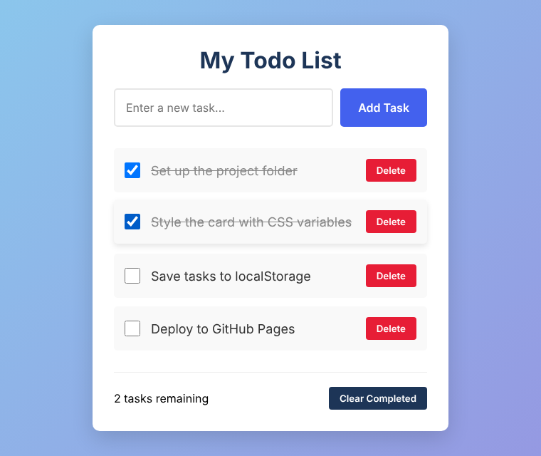
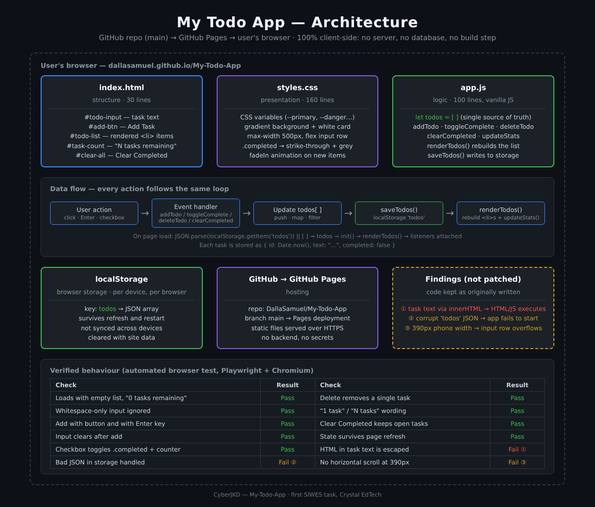
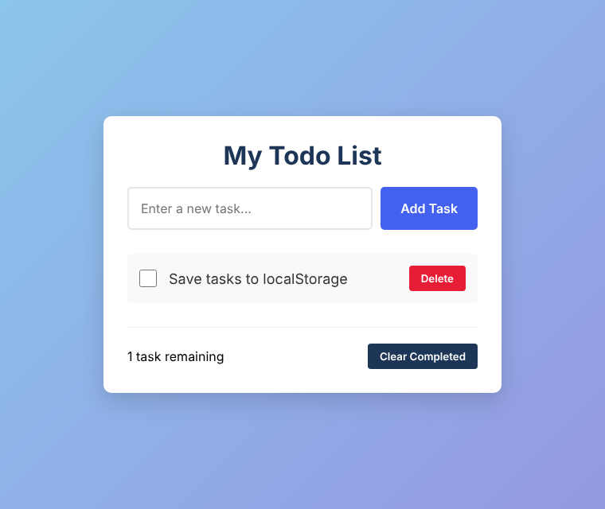
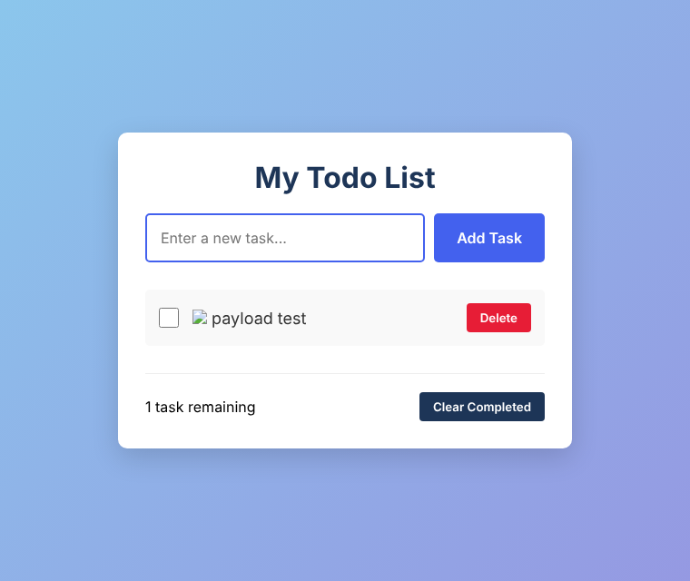
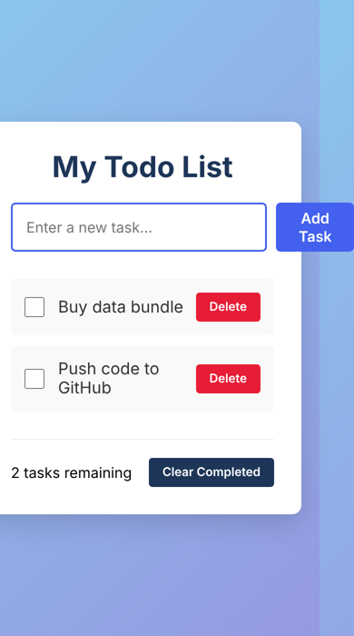

# My Todo App - Vanilla JavaScript Task Manager


| | |
|---|---|
| **Author** | Dalla Samuel (CyberJKD) |
| **Program** | SIWES (Students Industrial Work Experience Scheme) · task 1 of 2 · next: [Student Payment Portal](https://github.com/DallaSamuel/Student-Payment-Portal) |
| **Organization** | Crystal EdTech, Kaduna, Nigeria |
| **Instructors** | Bright Uto Daniel · Ayodele Daniel |
| **Date** | July 2025 |
| **Platform** | Browser (client-side only) · hosted on GitHub Pages |
| **Live Demo** | [dallasamuel.github.io/My-Todo-App](https://dallasamuel.github.io/My-Todo-App/) |



---

## Objective

Build a working to-do list app from scratch with only HTML, CSS and JavaScript. No frameworks, no libraries, no build tools. A user can add tasks, tick them off, delete them and clear finished ones, and the list must still be there after a page refresh.

> **The code is kept exactly as I first wrote it, on purpose.** One must always have a beginning, and this repo is mine. Instead of rewriting it, I came back later, tested it like I test my labs now, and documented what holds up and what doesn't (see [Findings](#findings)).

## Problem It Solves

Everyone keeps a running list of small jobs. A to-do app is the classic first project because it covers the core loop behind almost every web application: **take user input → update data → save it → redraw the screen**. Getting that loop right with plain JavaScript is the foundation for everything built on top of it later, frameworks included.

## Environment

| Component | Value |
|---|---|
| Languages | HTML5, CSS3, JavaScript (ES6+) |
| Frameworks / libraries | None |
| Storage | Browser `localStorage`, key `todos` |
| Hosting | GitHub Pages, `main` branch |
| Files | `index.html` (30 lines) · `styles.css` (160 lines) · `app.js` (100 lines) |
| Test tooling (added later, not in the repo) | Playwright + Chromium, desktop 760px and phone 390px viewports |

## Key Concepts

- **DOM manipulation**: finding elements with `getElementById`, creating `<li>` items with `createElement`, and rebuilding the list on every change.
- **Event listeners**: `click` on buttons, `keypress` for the Enter key, `change` on checkboxes.
- **Single source of truth**: one `todos` array holds the state. The screen is always redrawn *from* that array, never edited by hand.
- **Immutable updates**: `map()` to toggle a task and `filter()` to delete or clear, instead of changing items in place.
- **`localStorage` persistence**: the array is saved as JSON on every change and loaded back with `JSON.parse` on page load.
- **CSS custom properties**: colours defined once in `:root` (`--primary`, `--danger`, `--dark` …) and reused across the stylesheet.

## Architecture



```
GitHub repo: DallaSamuel/My-Todo-App (main)
   │
   ▼
GitHub Pages ──► https://dallasamuel.github.io/My-Todo-App/
   │
   ▼
User's browser (everything runs here, no server, no database)
   ├── index.html   → layout: #todo-input, #add-btn, #todo-list, #task-count, #clear-all
   ├── styles.css   → theme variables, gradient background, card, .completed style, fadeIn
   ├── app.js       → todos[] state + handlers
   │     ├── addTodo()        push new { id: Date.now(), text, completed: false }
   │     ├── toggleComplete() map → flip completed
   │     ├── deleteTodo()     filter → remove by id
   │     ├── clearCompleted() filter → keep open tasks
   │     ├── saveTodos()      localStorage.setItem('todos', JSON)
   │     └── renderTodos()    rebuild <li> list → updateStats()
   └── localStorage['todos'] → loaded once on page load
```

Every user action runs the same loop: **event → handler → update `todos` → `saveTodos()` → `renderTodos()`**. On page load the app reads `localStorage`, falls back to an empty list, renders it and attaches the listeners.

## Features

| Feature | How it works |
|---|---|
| Add a task | **Add Task** button or **Enter** key. Input is trimmed, so empty or whitespace-only text is ignored. The input clears and refocuses after each add. |
| Complete a task | Checkbox toggles `completed`; the item gets a strike-through style. |
| Delete a task | **Delete** removes that one task by its `id`. |
| Clear completed | **Clear Completed** removes every finished task and keeps the open ones. |
| Live counter | "1 task remaining" / "N tasks remaining", counting open tasks only. |
| Persistence | Saved to `localStorage` on every change, so the list survives refresh and browser restart (on the same device and browser). |

<table>
<tr>
<td></td>
<td></td>
</tr>
<tr>
<td align="center"><sub>4 tasks added (button + Enter)</sub></td>
<td align="center"><sub>After Clear Completed: open task kept</sub></td>
</tr>
</table>

## Run It Locally

```bash
# Clone
git clone https://github.com/DallaSamuel/My-Todo-App.git
cd My-Todo-App

# Open in a browser, no install or build step
start index.html      # Windows
open index.html       # macOS
xdg-open index.html   # Linux

# Reset the app (browser DevTools console)
localStorage.removeItem('todos')
```

## Verification Checklist

Tested in a real browser (Playwright driving Chromium) against the original, unmodified code.

- [x] Loads with an empty list and "0 tasks remaining"
- [x] Whitespace-only input is ignored
- [x] Tasks can be added with the button and with the Enter key
- [x] Input clears after each add
- [x] Checkbox marks a task complete and the counter updates
- [x] Delete removes exactly one task
- [x] Counter uses "1 task" vs "N tasks" correctly
- [x] Clear Completed removes finished tasks and keeps open ones
- [x] Tasks and their completed state survive a page refresh
- [x] Live site on GitHub Pages loads the app
- [ ] Task text containing HTML is shown as plain text: **fails, see Finding 1**
- [ ] App recovers from corrupted saved data: **fails, see Finding 2**
- [ ] No sideways scrolling at phone width (390px): **fails, see Finding 3**

## Findings

I'm building toward cloud security, so I looked at my first project the same way I'd look at anyone else's. The code stays as it was. These are documented, not patched.

**1. HTML injection via `innerHTML` (security).** `renderTodos()` puts the task text into the page with a template string assigned to `innerHTML`:

```javascript
<span class="todo-text">${todo.text}</span>
```

Anything typed into the box is treated as HTML, not text. Adding the task `` ran the JavaScript inside it, and because the task is saved to `localStorage`, it **ran again on every page reload**. Impact here is limited: the data never leaves the user's own browser, so only that user is affected (self-XSS). In any app where one user's input is shown to another user, the same pattern is a stored cross-site scripting (XSS) vulnerability.
*Fix:* create the `<span>` with `createElement` and set `span.textContent = todo.text`, which never interprets HTML.



**2. Corrupted saved data stops the app from starting (reliability).** Line 9 runs `JSON.parse(localStorage.getItem('todos'))` with no error handling. When the saved value was set to invalid JSON, the page threw `SyntaxError` on load and none of the buttons worked until the storage was cleared by hand.
*Fix:* wrap the parse in `try/catch` and fall back to an empty list.

**3. Input row overflows on phones (layout).** At a 390px-wide screen the page scrolled sideways (content was 428px wide) and the card was cut off on the left. The text input sits in a flex row, and an `<input>` won't shrink below its default width unless told to.
*Fix:* add `min-width: 0` to `#todo-input`, and stack the input and button below about 400px with a media query.



**Minor notes.** IDs come from `Date.now()`, so two tasks added in the same millisecond (e.g. by a script) would share an ID and delete or toggle together. Data is per browser and per device, with no sync or export.

## What I'd Change for Production

- **Render user text with `textContent`**, never `innerHTML` (Finding 1). Add a Content Security Policy as a second layer.
- **Validate and recover stored data** with `try/catch` and a schema check on load (Finding 2).
- **Responsive layout**: `min-width: 0` on the input plus a small-screen media query (Finding 3).
- **`crypto.randomUUID()`** for task IDs instead of `Date.now()`.
- **Accessibility**: a `<label>` for the input, `aria-label`s on the checkbox and Delete buttons, and visible focus styles.
- **Edit in place**, plus export/import as JSON so a list can move between devices.
- **Automated tests in CI**: run the Playwright checks above on every push with GitHub Actions.
- **A backend with authentication** (e.g. an API with a database) only if multi-device sync is ever needed. At that point Finding 1 becomes a real stored XSS risk and must be fixed first.

## Where It Led

This was the start. My second SIWES task was the [Student Payment Portal](https://github.com/DallaSamuel/Student-Payment-Portal). After these two tasks I could see the SIWES projects weren't lined up with where I wanted to go: cloud and security. So I built my own learning plan, the [CyberJKD Roadmap](https://dallasamuel.github.io/CyberJKD-Roadmap), and presented it to my instructors. Instead of pushing back, Ayodele Daniel adopted it for his own path, and from then on we worked through it together, learning side by side rather than as teacher and student.

Since then my work has moved into **Azure cloud support and IT support**: Terraform, Active Directory, NTFS file servers, Splunk, Nessus and ServiceNow, all documented in the same style as this README.

---

🌐 Full roadmap: [dallasamuel.github.io/CyberJKD-Roadmap](https://dallasamuel.github.io/CyberJKD-Roadmap)

🔗 All labs: [github.com/DallaSamuel/CyberJKD-Labs](https://github.com/DallaSamuel/CyberJKD-Labs)

👤 GitHub profile: [@DallaSamuel](https://github.com/DallaSamuel) · LinkedIn: [dallasamuel](https://www.linkedin.com/in/dallasamuel)

---

*CyberJKD - Becoming dangerous through fundamentals. 🔒*
